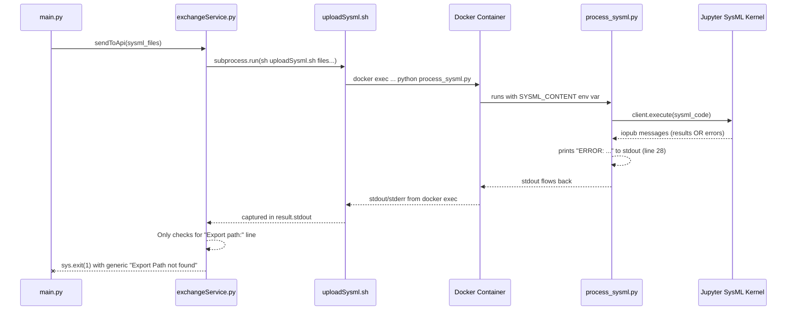

# Surface SysML Parsing Errors to Console

## Problem

When a `.sysml` file has syntax/semantic errors, the conversion silently fails — the Jupyter SysML kernel inside the Docker container reports the error, but it never reaches the user's console. The current behavior is:

1. `exchangeService.py` calls `uploadSysml.sh` via `subprocess.run`
2. The shell script does `docker exec` to run `process_sysml.py` inside the container
3. `process_sysml.py` feeds SysML code to the Jupyter kernel and reads messages back
4. **Errors ARE detected** in `process_sysml.py` (line 27–28) — it prints `ERROR: ...` to stdout
5. **But**: `exchangeService.py` only looks for the `"Export path:"` line. If the export fails (due to errors), it logs `"Export Path not found in output"` and calls `sys.exit(1)` — the actual kernel error messages are **swallowed**.

## Architecture Overview



The error text from the kernel **is already in `result.stdout`** inside `exchangeService.py`, it's just not printed to the console.

## Proposed Changes

### Component 1: Container-side error propagation (process_sysml.py)

#### [MODIFY] [process_sysml.py](file:///c:/Users/gerri/Desktop/Sashko/DigitalTwinProfileSysMLv2/apiserver/process_sysml.py)

- Make `run_cmd()` **collect and return errors** instead of just printing them
- Make `run_task()` check for errors after each `run_cmd()` call
- Print a clear `ERROR_SUMMARY:` block with all errors so it's easy to parse on the host side
- Exit with non-zero code when errors are present

```diff
 def run_cmd(cmd, timeout=600):
+    errors = []
     msg_id = client.execute(cmd)
     while True:
         msg = client.get_iopub_msg(timeout=timeout)
         if msg["header"]["msg_type"] in ("execute_result", "display_data"):
             ...  # unchanged
         if msg["header"]["msg_type"] == "error":
-            print(f"ERROR: {msg['content']['ename']}: {msg['content']['evalue']}", flush=True)
+            ename = msg['content']['ename']
+            evalue = msg['content']['evalue']
+            traceback_lines = msg['content'].get('traceback', [])
+            error_msg = f"{ename}: {evalue}"
+            errors.append(error_msg)
+            print(f"ERROR: {error_msg}", flush=True)
+            for tb_line in traceback_lines:
+                print(f"  {tb_line}", flush=True)
         if (...idle...):
             break
+    return errors

 def run_task():
     ...
-    run_cmd(wrapped_content)
+    errors = run_cmd(wrapped_content)
+    if errors:
+        print("\nERROR_SUMMARY: SysML parsing failed", flush=True)
+        for e in errors:
+            print(f"  | {e}", flush=True)
+        sys.exit(1)     # ← stops before attempting export
     ...
-    run_cmd(f"%export {safe_name}")
+    export_errors = run_cmd(f"%export {safe_name}")
+    if export_errors:
+        print("\nERROR_SUMMARY: Export failed", flush=True)
+        for e in export_errors:
+            print(f"  | {e}", flush=True)
+        sys.exit(1)
```

> [!NOTE]
> This requires adding `import sys` at the top of `process_sysml.py` (currently it uses `os._exit`).

---

### Component 2: Host-side error surfacing (exchangeService.py)

#### [MODIFY] [exchangeService.py](file:///c:/Users/gerri/Desktop/Sashko/DigitalTwinProfileSysMLv2/src/exchangeService.py)

- When `subprocess.run` returns a non-zero exit code, **parse and print the actual error lines** from stdout/stderr instead of just logging generically
- Raise a descriptive exception instead of `sys.exit(1)` so callers can handle it
- Also extract and print error lines even when the return code is 0 but no export path is found (edge case)

```diff
     def sendToApi(self, data: list) -> str:
         logging.info("Uploading SysML files to the API...")
         print(f">> Uploading files: {data}", flush=True)
         result = subprocess.run(
             ['sh', self.upload_script_path] + data,
             stdout=subprocess.PIPE, stderr=subprocess.PIPE,
             stdin=subprocess.DEVNULL,
             text=True
         )
+
+        # Extract and display any SysML errors from the container output
+        error_lines = [l for l in result.stdout.splitlines() if l.startswith("ERROR") or l.startswith("  |")]
+        if error_lines:
+            print("\n╔══ SysML Conversion Errors ══════════════════════════╗", flush=True)
+            for line in error_lines:
+                print(f"║  {line}", flush=True)
+            print("╚════════════════════════════════════════════════════╝\n", flush=True)
+
         if result.returncode != 0:
-            logging.error("STDOUT: %s", result.stdout)
-            logging.error("STDERR: %s", result.stderr)
-            sys.exit(1)
+            if result.stderr.strip():
+                logging.error("STDERR: %s", result.stderr)
+            raise RuntimeError(
+                f"SysML conversion failed. See errors above. "
+                f"(exit code {result.returncode})"
+            )

         logging.info("Full STDOUT: %s", result.stdout)

         export_line = next((l for l in result.stdout.splitlines() if "Export path:" in l), None)
         if not export_line:
-            logging.error("Export Path not found in output")
-            sys.exit(1)
+            logging.error("Export Path not found in container output")
+            raise RuntimeError(
+                "SysML conversion produced no export. The SysML file(s) likely contain errors."
+            )
```

---

### Component 3: Caller-side error handling (main.py)

#### [MODIFY] [main.py](file:///c:/Users/gerri/Desktop/Sashko/DigitalTwinProfileSysMLv2/src/main.py)

- Wrap the `sendToApi` call in `parseSysmlToTwinClass` with a try/except to catch `RuntimeError` and print a user-friendly message instead of crashing with a traceback

```diff
 def parseSysmlToTwinClass(sysmlDirPath: str, outputFolder="output") -> list[Twin]:
     ...
-    path = exchangeService.sendToApi(sysml_files)
+    try:
+        path = exchangeService.sendToApi(sysml_files)
+    except RuntimeError as e:
+        logging.error(str(e))
+        sys.exit(1)
     ...
```

## Open Questions

> [!IMPORTANT]
> **Traceback detail level**: The SysML kernel's error traceback can include ANSI escape codes (color formatting from Jupyter). Should I strip those out for clean console output, or leave them as-is?

> [!NOTE]
> **Docker image rebuild**: The change to `process_sysml.py` lives inside the Docker image. After merging, you'll need to rebuild the image (`docker build -f Dockerfile.jupyter ...`) for the changes to take effect. Is that acceptable, or do you want me to also set up a volume-mount approach so `process_sysml.py` can be updated without rebuilding?

## Verification Plan

### Manual Verification
1. Create a `.sysml` file with a deliberate syntax error (e.g., missing semicolon or undefined type)
2. Run `python -m src.main <path-to-broken-sysml-dir>`
3. Verify that the console shows the specific error message from the kernel (e.g., `"Couldn't resolve reference to Type 'UndefinedType'"`)
4. Verify that a valid `.sysml` file still converts successfully
